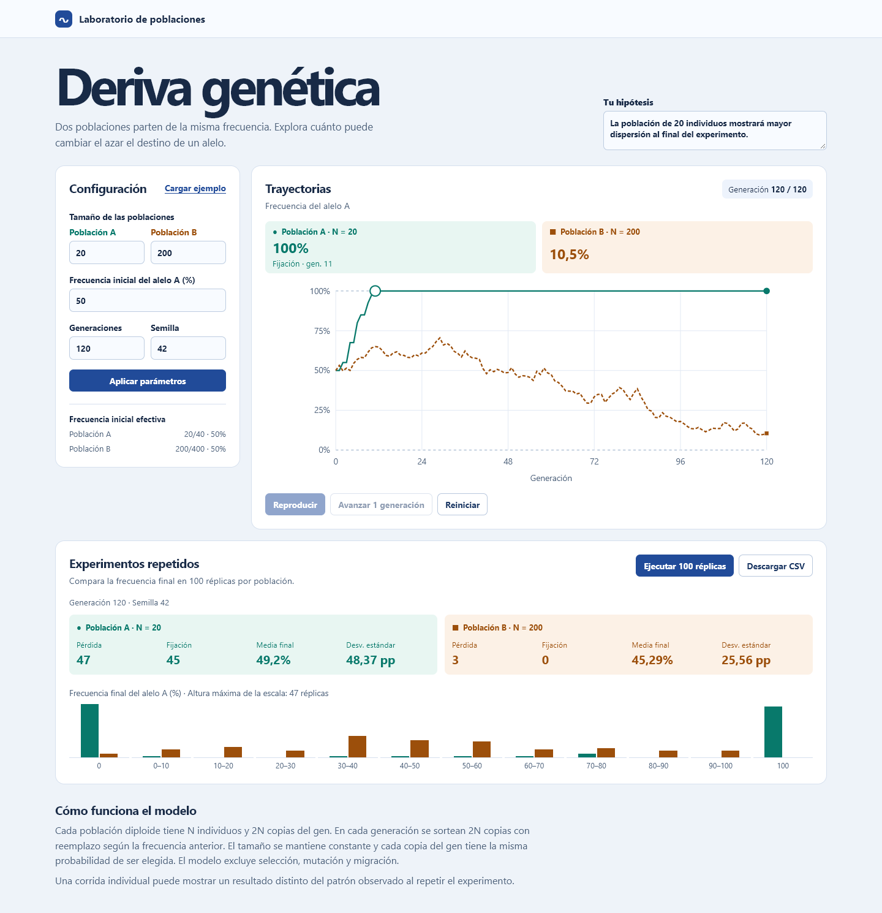

# Simulador de deriva genética

[Abre la demo en GitHub Pages](https://humiumii.github.io/simulador-deriva-genetica/)

Compara dos poblaciones ficticias y estudia cuánto cambia una frecuencia alélica por azar. Escribe una hipótesis, observa las trayectorias y contrasta la dispersión y los resultados extremos en 100 réplicas por población.



## Ejecutar en local

Requiere Node.js 24 y npm.

```sh
npm ci
npm run dev
npm test
npm run build
npm run preview
```

Vite genera un sitio estático en `dist/` con rutas relativas. GitHub Actions ejecuta las pruebas, construye el sitio y publica ese directorio en GitHub Pages. La simulación y la exportación ocurren en el navegador.

## Experimento reproducible

1. Selecciona **Cargar ejemplo**. Las poblaciones A y B tienen 20 y 200 individuos, respectivamente. Ambas parten al 50 %. El horizonte es de 120 generaciones y la semilla es 42.
2. Escribe la hipótesis «La población de 20 individuos mostrará mayor dispersión al final del experimento».
3. Selecciona **Reproducir** y observa el gráfico hasta la generación 120. A se fija en la generación 11 y B termina al 10,5 %.
4. Ejecuta las 100 réplicas y compara la desviación estándar. Repite el experimento con la misma semilla para recuperar los mismos resultados. Prueba la semilla 43 para observar una nueva muestra.
5. Descarga el CSV. Contiene 200 filas de datos y expresa las frecuencias como proporciones entre 0 y 1. Cada fila identifica la réplica, la población, los parámetros, las copias iniciales y finales y el estado final.

| Población | Pérdidas | Fijaciones | Media final | Desviación estándar |
| --- | ---: | ---: | ---: | ---: |
| A · 20 individuos | 47 | 45 | 49,2 % | 48,37 pp |
| B · 200 individuos | 3 | 0 | 45,29 % | 25,56 pp |

Una corrida individual puede diferir del patrón de las réplicas. Este ejemplo compara dos muestras de 100 corridas y la desviación estándar usa el divisor 100.

## Supuestos del modelo

- Modelo neutral de Wright–Fisher con dos alelos, generaciones discretas y poblaciones diploides de tamaño constante. Se excluyen selección, mutación y migración. [Descripción del modelo](https://www2.eecs.berkeley.edu/Pubs/TechRpts/2015/EECS-2015-94.pdf)
- El número de copias de A en la generación siguiente se obtiene con 2N sorteos independientes con reemplazo, cada uno con probabilidad igual a la frecuencia anterior. El simulador redondea las copias iniciales al entero más cercano, con los empates hacia arriba, y muestra la proporción efectiva por población.
- La pérdida (0 %) y la fijación (100 %) son estados absorbentes. El histograma reserva una barra para cada extremo y agrupa las frecuencias intermedias en intervalos de 10 puntos porcentuales. Cada intervalo incluye su límite inferior si es interior y excluye el superior.
- El motor TypeScript vive en `src/motor.ts`. El generador xoshiro128** separa los flujos pseudoaleatorios con saltos de 2⁶⁴ pasos. Las dos trayectorias de la vista y las 200 réplicas usan flujos distintos. El cálculo de réplicas se ejecuta en un Web Worker. [Referencia del generador](https://prng.di.unimi.it/)
- La interfaz admite de 1 a 1000 individuos por población, de 1 a 300 generaciones y semillas enteras de 0 a 4 294 967 295.
